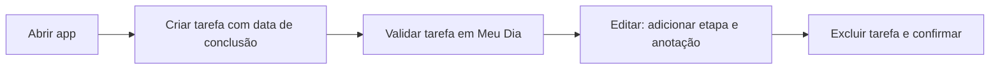

# 📱 Automação Mobile Android com Robot Framework + Appium

Automação E2E de um **aplicativo de lista de tarefas (To Do)** no Android, cobrindo o ciclo completo de uma tarefa: **criar → validar → editar → excluir**.

## 🚀 Stack

| Item | Tecnologia |
|---|---|
| Framework | Robot Framework |
| Automação mobile | Appium + AppiumLibrary (UiAutomator2) |
| Plataforma | Android (dispositivo físico) |
| Relatórios | Robot Framework `log.html` / `report.html` |
| CI | GitHub Actions (`.github/workflows/pipeline.yaml`) |

## 🧪 Fluxo automatizado



## 🗂️ Estrutura

```
Actions.robot           suíte principal: orquestra o fluxo completo
Base.robot              abertura do app e capabilities do Appium
Global_Variables.robot  mapeamento centralizado dos elementos (locators)
NewTask_Keywords.robot  keywords de criação de tarefa
Validate_Task.robot     keywords de validação
Edit_task.robot         keywords de edição
Delete_Task.robot       keywords de exclusão
results/                evidências da última execução (log, report, output)
```

**Boas práticas aplicadas:** keywords reutilizáveis por ação, locators centralizados em um único arquivo e separação entre suíte e implementação.

## ▶️ Como executar

Pré-requisitos: Python 3, Appium Server rodando em `http://localhost:4723`, dispositivo Android conectado com o app instalado.

```bash
pip install robotframework robotframework-appiumlibrary Appium-Python-Client
robot --outputdir results Actions.robot
```

Abra `results/report.html` para ver o relatório.
