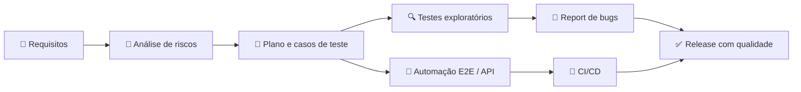

<!-- Banner -->
<p align="center">
  
</p>

<!-- Typing -->
<p align="center">
  <a href="https://github.com/loruhana">
    
  </a>
</p>

<p align="center">
  
  
</p>

---

## 👩‍💻 Sobre mim

```js
const loruhana = {
  role: "QA Analyst / QA Engineer",
  focus: ["Testes manuais e exploratórios", "Automação E2E", "Testes de API", "Qualidade no CI/CD"],
  mindset: "Se pode quebrar, eu vou descobrir como 🔍",
  learning: ["Playwright", "Testes de performance", "Shift-left testing"],
  askMeAbout: ["Cypress", "Postman", "BDD com Gherkin", "Planos e casos de teste"],
};
```

- 🐞 Apaixonada por **qualidade de software** e por caçar bugs antes que eles cheguem em produção
- 🤖 Transformo testes repetitivos em **automação confiável**
- 📋 Escrevo **casos de teste, cenários BDD e relatórios de bug** claros e reproduzíveis
- 🔄 Integro testes em **pipelines de CI/CD** para entregas com confiança

---

## 🧪 Stack de Qualidade

### Automação & Frameworks de Teste
<p>
  
  
  
  
  
  
</p>

### API & Performance
<p>
  
  
  
  
  
</p>

### Linguagens
<p>
  
  
  
  
</p>

### Gestão, CI/CD & Ferramentas
<p>
  
  
  
  
  
  
</p>

---

## 🔁 Como eu trabalho



---

## 📊 Estatísticas

<p align="center">
  
  
</p>

<p align="center">
  
</p>

<p align="center">
  
</p>

---

## 🐍 Caçando bugs nas contribuições

<p align="center">
  <picture>
    <source media="(prefers-color-scheme: dark)" srcset="https://raw.githubusercontent.com/loruhana/loruhana/output/github-contribution-grid-snake-dark.svg" />
    
  </picture>
</p>

---

## 🤝 Vamos conversar?

<p align="center">
  <a href="https://www.linkedin.com/in/loruhana-a-a67a31252/" target="_blank"></a>
  <a href="mailto:loruhanaenf@gmail.com" target="_blank"></a>
  <a href="https://github.com/loruhana" target="_blank"></a>
</p>

<p align="center">
  <i>"Testar é duvidar com método."</i> 🧪
</p>


