  

  
  
  

## ⚡ Em 10 segundos

| | |
|---|---|
| 🎯 **Cargo atual** | Lead Quality Assurance Engineer · SPDATA |
| 🧭 **Senioridade** | 7+ anos em QA · liderança técnica e gestão de qualidade |
| 🏗️ **Especialidade** | Arquitetura de automação (E2E, API, mobile, performance) e estratégia de testes |
| 📊 **Diferencial** | Métricas de qualidade e RCA que viram decisões de negócio · QA com agentes de IA |
| 🏦 **Experiência em** | Banco digital, SaaS e produtos digitais em ambiente ágil |
| 🌎 **Modelo** | Remoto |

  

## 👩‍💻 Sobre mim

Líder técnica de Qualidade, responsável por **arquitetura de automação**, **governança de processos** e evolução da **maturidade de engenharia de testes**. Atuo de ponta a ponta: da estratégia de testes ao desenvolvimento e revisão de automações, sempre em ambiente ágil e **orientada a dados**.

<table>
<tr>
<td width="50%" valign="top">

### 🏗️ Automação de testes
Frameworks por camadas (Page Objects, Services, Hooks, Utils), padronização de código, versionamento e guidelines. E2E, API, regressão e integração com **Playwright, Cypress e Robot Framework**.

### 🧭 Estratégia & processos
Estratégia de testes, critérios de aceite, **Definition of Done**, gestão de débito técnico e testes integrados ao **CI/CD**.

### 🚢 Gestão de releases
Ciclos de entrega com estabilidade, rastreabilidade e conformidade.

</td>
<td width="50%" valign="top">

### 📊 Métricas & melhoria contínua
Dashboards de taxa de falhas, cobertura, MTTR, retrabalho e SLA de bugs. **Root Cause Analysis** e reporte à Gerência de Tecnologia.

### 🤖 IA aplicada a QA
Agentes de IA para automatizar processos, validar fluxos e aumentar a eficiência dos testes.

### 👥 Pessoas & ágil
Revisão de cenários e código, treinamentos, PDIs, 1:1, avaliações técnicas e cerimônias Scrum/Kanban.

</td>
</tr>
</table>

## 🗂️ Meus trabalhos

| Projeto | O que mostra | Stack |
|---|---|---|
| 🤖 [**Orquestrador de Qualidade com Agentes de IA**](Meus%20trabalhos/01-orquestrador-qualidade-agentes-ia) | Agentes que exploram, automatizam e revisam; acessibilidade com axe-core; CI agendado | `Playwright` `axe-core` `IA` `GitHub Actions` |
| 🔌 [**Automação de API REST**](Meus%20trabalhos/02-automacao-api-rest-playwright) | 55 testes: CRUD, JWT, contrato com schemas, rate limit e matriz de rastreabilidade | `TypeScript` `Playwright` `Zod` `Faker` |
| 📱 [**Automação Mobile E2E**](Meus%20trabalhos/03-automacao-mobile-webdriverio-appium) | Android, iOS e nuvem de dispositivos, data-driven, relatórios Allure | `WebdriverIO` `Appium` `BrowserStack` `Allure` |
| 📰 [**E2E de Portal de Notícias**](Meus%20trabalhos/04-e2e-portal-noticias-playwright) | Critérios de aceite em BDD e Page Object Model | `Playwright` `Gherkin` `POM` |
| 🤖 [**Mobile com Robot Framework**](Meus%20trabalhos/05-automacao-mobile-robot-framework) | Ciclo completo de tarefas em app Android com keywords reutilizáveis | `Robot Framework` `Appium` |
| 🛒 [**Cadastro E2E**](Meus%20trabalhos/06-cadastro-e2e-playwright) | Fluxo de cadastro em e-commerce com massa dinâmica | `Playwright` `Faker` `POM` |

## 🧪 Stack

  
  
  
  
  
  
  
  
  
  

  
  
  
  
  
  
  
  
  
  
  
  

## 🚀 Trajetória

  

## 🐍 Contribuições

  <picture>
    <source media="(prefers-color-scheme: dark)" srcset="https://raw.githubusercontent.com/loruhana/loruhana/output/github-contribution-grid-snake-dark.svg" />
    
  </picture>

  <i>"Transformar dados em decisões, processos em cultura e qualidade em diferencial competitivo."</i>

