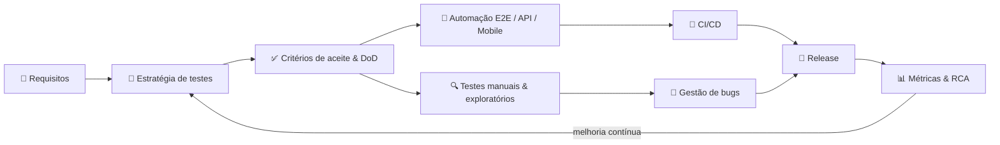

<!-- Banner -->
<p align="center">
  
</p>

<!-- Typing -->
<p align="center">
  <a href="https://github.com/loruhana">
    
  </a>
</p>

<p align="center">
  
  
  
</p>

---

## 👩‍💻 Sobre mim

Líder técnica de Qualidade, responsável por **arquitetura de automação**, **governança de processos** e evolução da **maturidade de engenharia de testes**. Atuo de ponta a ponta: da estratégia de testes ao desenvolvimento e revisão de automações, sempre em ambiente ágil e **orientada a dados**.

```js
const loruhana = {
  cargo: "Lead Quality Assurance Engineer @ SPDATA",
  foco: ["Arquitetura de automação", "Estratégia de testes", "Métricas de qualidade", "Liderança técnica"],
  automacao: ["E2E", "API", "Regressivos", "Integração", "Mobile", "Performance"],
  padroes: ["Page Objects", "Services", "Hooks", "Utils", "Guidelines de código"],
  missao: "Transformar dados em decisões, processos em cultura e qualidade em diferencial competitivo",
};
```

### 🎯 O que eu faço

| | Área | Destaques |
|---|---|---|
| 🏗️ | **Automação de testes** | Frameworks estruturados por camadas (Page Objects, Services, Hooks, Utils), padronização de código e versionamento com Git. Automação E2E, API, regressiva e de integração com **Playwright, Cypress e Robot Framework** |
| 🧭 | **Estratégia & processos** | Estratégia de testes, critérios de aceite e **Definition of Done**, gestão de débito técnico em testes, documentação técnica e testes integrados em **CI/CD** |
| 🔍 | **Testes manuais & automatizados** | Cenários e casos de teste a partir de requisitos, testes funcionais, regressivos, exploratórios e de integração, gestão de bugs com os times de dev |
| 📊 | **Métricas & melhoria contínua** | Dashboards de qualidade (taxa de falhas, cobertura, MTTR, retrabalho, SLA de bugs), **Root Cause Analysis** e reporte à Gerência de Tecnologia |
| 🚢 | **Gestão de releases** | Coordenação de ciclos de entrega com estabilidade, rastreabilidade e conformidade |
| 🤖 | **IA aplicada a QA** | Agentes de IA para automatizar processos, validar fluxos e aumentar a eficiência dos testes |
| 👥 | **Pessoas & ágil** | Revisão de cenários e código, treinamentos, PDIs, 1:1, avaliações técnicas em seleção e cerimônias Scrum/Kanban |

---

## 🧪 Stack de Qualidade

### 🤖 Automação de testes
<p>
  
  
  
  
</p>

### 🔌 API & ⚡ Performance
<p>
  
  
  
  
</p>

### 📱 Mobile & Multiplataforma
<p>
  
  
  
  
</p>

### 💻 Linguagens
<p>
  
  
  
</p>

### 🗄️ Banco de dados & Infra
<p>
  
  
  
  
  
  
</p>

### 📊 Métricas & Observabilidade
<p>
  
  
  
</p>

### 🗂️ Gestão, Documentação & CI/CD
<p>
  
  
  
  
  
  
  
</p>

### 🧠 Metodologias
<p>
  
  
  
  
  
</p>

---

## 🚀 Trajetória

| Período | Cargo | Empresa |
|---|---|---|
| 2026 – atual | 🏆 **Lead Quality Assurance Engineer** | SPDATA |
| 2025 – 2026 | 🚢 **QA Release Manager** | Winnin |
| 2024 – 2025 | 📋 **QA Manager** | CSP Tech |
| 2021 – 2024 | 🏦 **Engenheira QA** | C6 Bank |
| 2020 – 2021 | ⚡ **Quality Engineer Pleno III** | Atlas |
| 2019 – 2020 | 🧪 **QA Engineer** | ZAMP |

---

## 🔁 Como eu trabalho



---

## 📊 Estatísticas

<p align="center">
  
  
</p>

<p align="center">
  
</p>

<p align="center">
  
</p>

---

## 🐍 Caçando bugs nas contribuições

<p align="center">
  <picture>
    <source media="(prefers-color-scheme: dark)" srcset="https://raw.githubusercontent.com/loruhana/loruhana/output/github-contribution-grid-snake-dark.svg" />
    
  </picture>
</p>

---

## 🤝 Vamos conversar?

<p align="center">
  <a href="https://www.linkedin.com/in/loruhana-a-a67a31252/" target="_blank"></a>
  <a href="mailto:loruhanaenf@gmail.com" target="_blank"></a>
  <a href="https://github.com/loruhana" target="_blank"></a>
</p>

<p align="center">
  <i>"Transformar dados em decisões, processos em cultura e qualidade em diferencial competitivo."</i> 🧪
</p>


